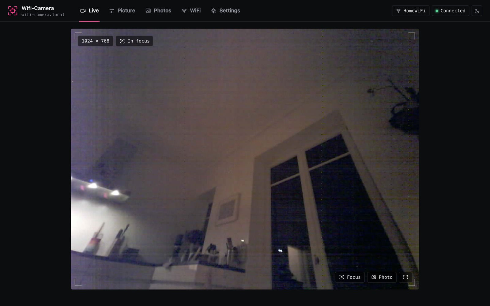
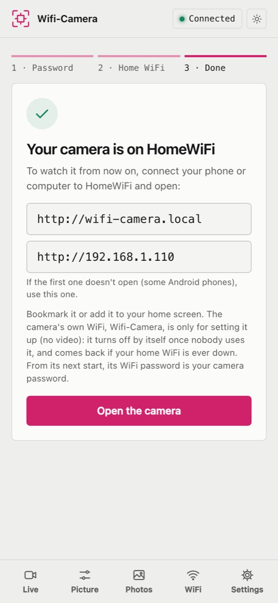
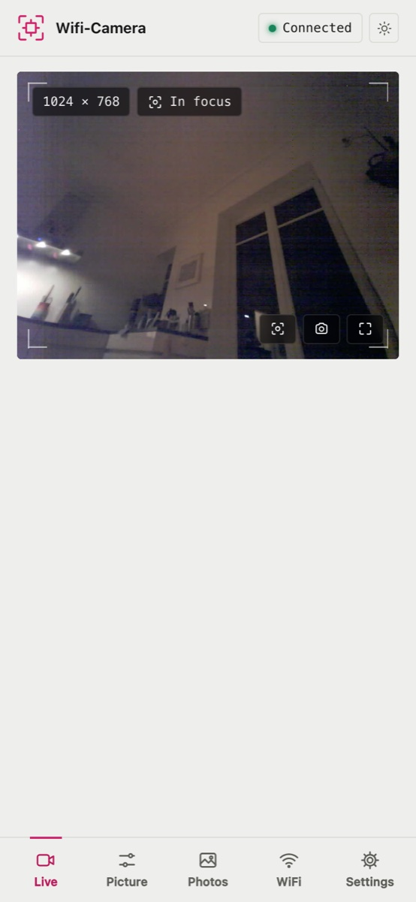
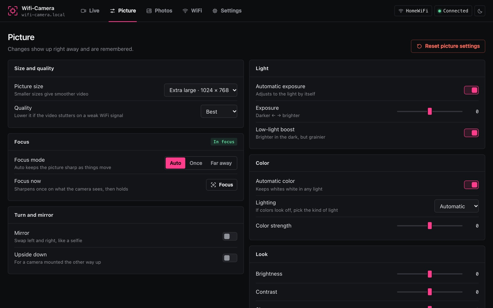

# Wifi-Camera

[](https://github.com/Tsmorz/esp32-cam/actions/workflows/ci.yml)
[](https://github.com/Tsmorz/esp32-cam/releases/latest)

**A private WiFi camera you set up from your phone — no app, no cloud, no terminal.**

Wifi-Camera is firmware for the **DFRobot FireBeetle 2 ESP32-S3** (N16R8) with an **OV5640 autofocus camera**. Flash it, join the camera's own WiFi, and a setup page opens by itself: choose a password, pick your home network, done. From then on, open `http://wifi-camera.local` in any browser to watch live video, adjust the picture, take photos and update the software.

Everything runs on the board. Video never leaves your home network, and it never goes over the camera's setup hotspot.



<p align="center">
  
  &nbsp;&nbsp;
  
</p>

## Highlights

- **Live video with autofocus** — MJPEG up to 1600×1200, auto, once or far-away focus on the OV5640's voice-coil lens
- **Phone-friendly setup** — captive portal ("Sign in to network") walks through password → home WiFi → the camera's address
- **Plain-language dashboard** — "password", "software update", "motion sensor", signal bars; engineering details tucked under *Advanced details*
- **Safe software updates over WiFi** — the file is checked before upload, and a new version that fails to start rolls back to the previous one on its own
- **Private by design** — password required for video, passwords encrypted with a key burned into the chip, no cloud, no CORS, DNS-rebinding protection
- **Optional add-ons** — memory card (photos, clips, timelapse), on-device animal detection (TensorFlow Lite), compass and tilt, deep sleep woken by motion

## What you need

| | Part | Notes |
|---|------|-------|
| **Required** | DFRobot FireBeetle 2 ESP32-S3 (N16R8, 16 MB flash, 8 MB PSRAM) | V1.0 and V1.1+ both work |
| **Required** | OV5640 camera with autofocus (e.g. DC5640-AF) | The stock OV2640 also works, without focus control |
| Optional | [Adafruit LSM6DSOX + LIS3MDL 9-DoF board](https://www.adafruit.com/product/4517) | Compass, tilt, motion triggers, wake from sleep. Plugs into STEMMA QT |
| Optional | SPI memory card, e.g. Adafruit SPI Flash SD Card (XTSD 512 MB) | Photos, clips, timelapse |
| Optional | A `.tflite` image model + labels (e.g. from Edge Impulse) | Animal detection, runs on the camera |

## Get started

### 1. Put the software on the board

**Easiest — no tools to install:** download `esp32-cam-<version>-factory.bin` from the [latest release](https://github.com/Tsmorz/esp32-cam/releases/latest), open the [ESP web flasher](https://espressif.github.io/esptool-js/) in Chrome or Edge, connect the board over USB, and write the file at address **`0x0`**.

**From the command line:**
```bash
esptool.py --chip esp32s3 write_flash 0x0 esp32-cam-<version>-factory.bin
```

**From source** (needs [ESP-IDF v5.5.5](https://docs.espressif.com/projects/esp-idf/en/v5.5.5/esp32s3/get-started/) in `~/esp/v5.5.5/esp-idf` or `$IDF_PATH`, and [Task](https://taskfile.dev)):
```bash
task init                              # checks tools, creates main/secrets.h, fetches the components
task flash PORT=/dev/cu.usbmodem1101   # build, flash over USB, open the serial monitor
```

After the first flash, **unplug and replug the board** (the camera's power chip needs a cold start). Later updates go over WiFi from the dashboard — no cable.

### 2. Set it up from your phone

1. Join the WiFi network **`Wifi-Camera`** — password **`wificamera`**.
2. The setup page opens by itself (otherwise open `http://192.168.4.1`).
3. **Choose a password.** The first person to do this owns the camera, so do it right after flashing.
4. **Pick your home WiFi** and enter its password. The camera joins it and shows you its new address.

### 3. Watch

Rejoin your home WiFi and open **`http://wifi-camera.local`** (on Android, use the IP address the setup page showed you). Enter the password once per browser and the live view starts.

> **Forgot the password?** Hold the board's **BOOT** button for 5 seconds until the LED blinks fast, then let go. The camera restarts without a password and the next visitor chooses a new one.

## Demo in five minutes

1. **Setup** — join `Wifi-Camera` on a phone; the setup page pops up. Choose a password, pick the home network.
2. **Live** — open `wifi-camera.local` on a laptop. Point the camera at something close, then far: *Auto* focus follows. Tap *Focus* to sharpen once and hold.
3. **Picture** — switch size and quality presets, turn, mirror or straighten the picture, change color and light. Everything applies instantly and survives a restart.
4. **Privacy** — open the page in a second browser: it asks for the password before showing any video. Rejoin the camera's hotspot: settings work, video doesn't.
5. **Second viewer** — with the stream open in one tab, open another: it says someone else is watching instead of hanging on a blank frame.
6. **Software update** — Settings → *Software update*, pick a `esp32-cam-<version>.bin` from the releases. Watch it upload, install, run on trial for 20 seconds, and confirm.

## The dashboard

| Page | What's there |
|------|--------------|
| **Live** | The video, as large as the window allows: size, focus, photo to this device, save and record to the memory card, full screen, what the animal model sees. With the motion sensor: a compass, side and front tilt, and compass calibration |
| **Picture** | Size and quality presets, focus, turn (90° steps), mirror, straighten a wall seen at an angle, light, color, look. Kept across restarts |
| **Photos** | The memory card: gallery (clips play in the page), download, delete, take a photo or record; automatic timelapse, photos when the camera is moved or an animal is seen |
| **WiFi** | Home network with signal bars and the addresses to open, the camera's own WiFi on/off, find and join a network |
| **Settings** | Version, temperature, motion sensor; animal detection; sleep; software update; password; set up again, restart, reset. *Advanced details* has the add-ons' wiring |



The whole dashboard is one gzipped page (~25 KB) inside the firmware, with no web fonts or outside assets, so it works on the hotspot with no internet. Light and dark follow the system until you pick one.

It looks after itself:
- **The stream is released when nobody's looking** — a hidden tab or another page lets go of the single stream slot.
- **A lost connection says so**, with the time of the last values, which stay on screen faded.
- **Updates are followed to the end** — *Updated*, *Failed to start, back on the previous version*, or *Still on version X* — and restarts reconnect by themselves.

## Security and privacy

- **The hotspot is for setup only.** Video, snapshots and motion readings answer only on the home network, and only with the password (sent as a header, or a cookie the dashboard gets for the `` stream).
- **Passwords are encrypted at rest** (AES-256-GCM). The key comes from the chip's HMAC peripheral, using a random key the firmware burns into a read-protected **eFuse** block on first boot — permanent, and never readable by software. A dump of the flash doesn't reveal the passwords.
- **Once a password is set, it also becomes the hotspot's WiFi password** (from the hotspot's next start), unless you fix one with `AP_PASS`.
- **Every request is checked for the camera's own host name**, which also shuts out DNS rebinding. No route sends CORS headers, and every change is a POST that needs the password.
- **Nothing leaves the board** — no cloud, no account, no telemetry. Animal detection runs on the camera.
- Photos on the memory card are not encrypted.

## Status LED

| Pattern | Meaning |
|---------|---------|
| On | Running |
| Fast blink | Starting up |
| Slow blink | Joining WiFi |
| Double blink | Camera failed to start (the dashboard and updates still work) |
| Flicker | Software update in progress |

## Optional add-ons

Wire the memory card and the motion sensor's wake pin to free GPIOs (9–18, 38, 47 — check which your board brings out), then select those pins under Settings → *Advanced details* and restart.

> **Hardware status:** the camera, autofocus, dashboard, WiFi setup, encrypted passwords and over-the-air updates are tested on the board. The memory card, sleep and the motion sensor are host-tested but **not yet tried on real hardware**; animal detection has been run on the board with a stand-in model.

### Memory card

- Files: `/WCAM/IMG_00001.JPG` and `/WCAM/VID_00002.MOV`, one numbering, timestamps from the internet clock. A new card is formatted by itself
- Clips are **QuickTime Motion-JPEG** — they play in QuickTime (Mac, iPhone), VLC and the dashboard. 512 MB holds ~10,000 photos at 800×600 or ~50 min of 320×240 video
- Automatic **timelapse** (every 1–60 min), or a photo/clip **when the camera is moved** or **an animal is seen** (then a 30 s pause)
- While recording, the live stream gets about half the frames

### Animal detection

Upload a **TensorFlow Lite** model and its labels under Settings → *Animal detection* — for example one trained in Edge Impulse. It runs with TensorFlow Lite Micro and Espressif's esp-nn kernels.

- Classifiers (what the picture shows) or **FOMO** grids (also *where* — marks on the live video); int8, uint8 or float; gray or RGB; any input size
- *Picture values* must match training: 0..1 (Edge Impulse), −1..1 (MobileNet) or 0..255
- Labels like `background`, `none` or `no …` mean "nothing seen" and never trigger; *Only these animals* narrows the triggers
- Measured: TensorFlow's 96×96 person-detection model takes 133 ms per look, including the JPEG decode

### Compass and tilt

- Adafruit LSM6DSOX + LIS3MDL on the shared I²C bus (GPIO 1/2, STEMMA QT); both I²C addresses of each chip are probed. Without it, the dashboard simply hides the motion card
- Orientation from a port of the **VQF** filter: gyro + accelerometer for tilt, magnetometer for heading
- **Calibrate the compass** once: Live → Motion sensor → *Calibrate*, then turn the camera slowly in every direction until it finishes. Until then heading comes from the gyro and drifts
- Keep the camera still for a second after it starts (gyro bias)

### Sleep

With the motion sensor's **INT1** wired to GPIO 9–18, the camera can **deep sleep** after 5–60 idle minutes (Settings → *Sleep*). Moving it wakes it (~5 s to video). It stays awake while someone watches, records, is on the hotspot or during an update's trial; a timelapse wakes it on a timer, takes the photo without WiFi and sleeps again.

**Battery level:** the board charges a Li-ion cell on its BAT connector but can't measure it. Two equal resistors (e.g. 100 kΩ) from the battery's + to GPIO 9 or 10 and from there to GND, chosen under Settings → *Advanced details* → *Battery sense*, show the charge at the top of every page (accurate to about 10 %; it can't tell when it's charging).

## Troubleshooting

| Problem | Fix |
|---------|-----|
| No video on the camera's own WiFi | By design — the hotspot is for setup. Watch on the home network |
| The page keeps asking for the password | Enter it again under Settings → Password. Forgotten: hold BOOT 5 s |
| Black screen / camera error, LED double-blinks | Unplug and replug the board (a reset button isn't enough on first boot) |
| Joined the wrong WiFi network | Wait 30 s — the camera goes back to the network it had |
| Compass points the wrong way or wanders | Calibrate again, away from metal and magnets |
| Green/black dotted columns in the video | A known OV5640 JPEG artifact; a higher quality number roughly halves it. Root cause not found yet |
| No USB port shows up when flashing | Hold BOOT, tap RST, release BOOT, then flash |
| `wifi-camera.local` doesn't open | Use the IP shown by setup or on the WiFi page (some Android phones don't resolve `.local`) |

---

## For developers

### Building with your own defaults

Everything in `main/secrets.h` is optional and git-ignored (template: `main/secrets.example.h`):

```c
#define WIFI_SSID "MyNetwork"   // home network to join
#define WIFI_PASS "MyPassword"
#define API_TOKEN "..."         // the camera password, 8–63 printable chars, checked at compile time
#define AP_PASS   "..."         // fixed hotspot password
```

Without it — which is what CI and the release binaries are — the camera starts hotspot-only and unclaimed. Values from `secrets.h` are copied to the camera's flash (encrypted) on boot, so a later update with a release binary keeps them. A password compiled in can't be reset with the BOOT button.

### Commands

| Command | What it does | CI job |
|---------|--------------|--------|
| `task init` | First-time setup: check tools, create `main/secrets.h`, fetch the components | — |
| `task format` / `task format-check` | clang-format / fail on unformatted sources | Format |
| `task check` | cppcheck 2.22.0; fails on errors and warnings | Static analysis |
| `task test` | Host unit tests (CMake + CTest) — token rules, JSON helpers, VQF + compass, clip writer, detection maths, OV5640 timing, turn/mirror/straighten, camera name, battery. No board needed | Unit tests |
| `task build` | Compile with ESP-IDF → `build/wifi-camera.bin` (updates) and `build/wifi-camera-factory.bin` (blank board); also embeds the dashboard and version | Build |
| `task ci` | All four, in CI's order | — |
| `task flash` / `task monitor` | Flash over USB and open the serial monitor / monitor only (`PORT=…`) | — |
| `task menuconfig` / `task size` / `task clean` | Browse the configuration (copy changes into `sdkconfig.defaults`) / memory use / remove build output | — |
| `task smoke -- -H <ip>` | Check a running board: routes, password, POST-only, no CORS, Host check, video rules | — |
| `task ota-rollback-test` | Update with a deliberately crashing image and check the board rolls back | — |
| `task factory` | Erase all flash, including saved settings | — |

Update over WiFi from the command line:
```bash
curl -H "X-Token: $TOKEN" -H "Content-Type: application/octet-stream" \
     --data-binary @build/wifi-camera.bin http://wifi-camera.local/ota
```

### Releases

CI (`.github/workflows/ci.yml`) runs Format, Static analysis, Unit tests and Build in parallel on every push and pull request.

- **`main`:** every push gets the next version once all checks pass — patch by default; `#minor` or `#major` in a commit message or the PR title bumps that instead. `scripts/next_version.sh` decides.
- **`development`:** updates the rolling pre-release **`dev`** in place (`esp32-cam-dev.bin`, `esp32-cam-dev-factory.bin`), reporting e.g. `v1.4.1-dev.3+3da6968`.
- **Manual:** push a `v*` tag; tags with a hyphen (`v1.5.0-rc1`) become pre-releases.

Each release has `esp32-cam-<version>.bin` (for updates over WiFi), `esp32-cam-<version>-factory.bin` (bootloader + partitions + app, for a blank board at `0x0`) and `SHA256SUMS`.

### How it works

**Two HTTP servers**, because an ESP-IDF httpd runs every handler on one task and the endless MJPEG handler would block everything else: control on port **80** (dashboard, JSON, settings, updates) and stream on port **81** (one viewer at a time). Handlers never block — slow work (focus moves, WiFi joins, scans, restarts) is queued and done from `loop()`.

| Core | Task | Priority | Role |
|------|------|----------|------|
| 0 | WiFi / esp_timer / lwIP / camera DMA | 23 / 22 / 18 / SDK | Radio and capture |
| 0 | httpd control (:80) / stream (:81) / `files` | 6 / 5 / 5 | Routes, MJPEG, gallery downloads |
| 1 | `imu` | 10 | 52 Hz sampling + VQF (only with the sensor) |
| 1 | `rec` | 3 | Photos, clips, timelapse (only with a card) |
| 1 | `detect`, `led`, Arduino `loop()` | 1 | Inference, status LED, serial, autofocus, housekeeping |

The camera needs no core of its own: the sensor encodes JPEG and frames arrive by DMA.

**WiFi** runs the hotspot and the home connection at once. The hotspot turns off 30 s after the home connection is up and unused, and comes back if it drops. A network joined from the dashboard is only saved once it worked. While the hotspot is on, a DNS server answers every name with the camera's address — that's what makes phones open the setup page.

**Software updates** boot on trial: confirmed 20 s after start-up once the servers run and the camera is on a network. A crash or reset before that brings back the previous version; never becoming healthy rolls back after 2 minutes.

**Autofocus:** the OV5640's focus motor is driven by an MCU inside the sensor, whose firmware (from [ESP32-OV5640-AF](https://github.com/0015/ESP32-OV5640-AF), MIT) is uploaded over I²C at every boot.

**Saved settings** live in NVS under one versioned layout (`main/settings.h`) with migrations; after encrypting old plain-text values the partition is rewritten, because NVS leaves deleted values in flash.

<details>
<summary><b>HTTP API</b></summary>

🔒 = needs header `X-Token: <password>`. 🎥 = home network only (403 over the hotspot) and the password, as `X-Token` or the `wc_video` cookie.

Control server, port **80**:

| Path | Description |
|------|-------------|
| `GET /` | Dashboard |
| `POST /auth/claim` | Only while no password is set: body = the password, header `X-Claim: 1`. Also sets the video cookie |
| `GET /auth` 🔒 | `OK` if the password is right; sets the HttpOnly video cookie |
| `GET /auth/forget` | Drops the video cookie |
| `GET /status` | Version, build, uptime, update trial state, sensor, focus, temperature, memory, motion sensor, storage, power, detection, WiFi. `?bg=1` doesn't count as activity for sleep |
| `GET /camera/status` | Camera settings, focus state, `viewers` |
| `GET /snapshot` 🎥 | One JPEG at the stream's size |
| `GET /pose` 🎥 | Orientation quaternion (sensor → East-North-Up), heading source, compass calibration progress |
| `GET /wifi/scan[?refresh=1]` | Nearby networks; answers `{"scanning":true}` until a scan is done |
| `GET /stream` | 302 to `:81/stream` |
| `POST /camera/set?var=&val=` 🔒 | `framesize`, `quality`, `brightness`, `contrast`, `saturation`, `sharpness`, `ae_level`, `awb`, `aec`, `agc`, `hmirror`, `rotate` (quarter turns clockwise, 0–3), `wb_mode`, `af` (0 infinity, 1 once, 2 continuous), `quad` (straightening: `x0,y0,…,x3,y3` in thousandths of the picture as shown, clockwise from top left; empty = off) |
| `POST /wifi/connect` 🔒 | `{"ssid","pass"}` — saved once it worked |
| `POST /wifi/hostname?name=` 🔒 | Rename the camera: `http://<name>.local` (1–32 lowercase letters, numbers and dashes) |
| `POST /ota` 🔒 | Raw `firmware.bin`; refused while the last update is on trial |
| `POST /camera/reset` 🔒 | Forget camera settings and restart |
| `POST /imu/compass?do=start\|finish\|cancel\|clear` 🔒 | Compass calibration |
| `POST /settings/reset?scope=all\|camera\|wifi\|imu\|options\|token` 🔒 | Forget those settings and restart |
| `POST /system/reboot` 🔒, `POST /system/sleep` 🔒 | Restart / deep sleep now |
| `GET /options`, `POST /options/set?key=&val=` 🔒 | Wiring, automation, sleep and detection settings |
| `GET /files[?offset=&limit=]` 🎥 | Memory card contents, newest first |
| `GET /files/get?name=[&dl=1]` 🎥 | One photo or clip |
| `POST /files/delete?name=\|all` 🔒 | Delete |
| `POST /capture/photo` 🔒, `POST /capture/record?do=start\|stop` 🔒 | Save a photo / record a clip |
| `GET /detect` 🎥 | Model info and latest results |
| `POST /model?name=&model_len=&labels_len=&range=` 🔒, `POST /model/forget` 🔒 | Upload (body = `.tflite` then labels) / remove the model |

Stream server, port **81**: `GET /stream` 🎥 — MJPEG, one viewer at a time.

Any other path: 404 when addressed to the camera, otherwise a redirect to the dashboard (captive portal).

</details>

<details>
<summary><b>Source layout</b></summary>

```
main/
  main.cpp              setup(), loop(), serial commands, BOOT-button reset
  config.h              Ports, task layout, pins; includes secrets.h
  camera.*              Camera init, settings + persistence, MJPEG handler
  camera_profile.*      Stream size, viewers, the sensor lock
  camera_light.*, ov5640_timing.h  Lamp flicker filter, night mode
  view.h                Turn, mirror, straightening corners
  focus.*               OV5640 autofocus firmware upload and control
  http_server.*         Both HTTP servers, every route
  http_util.*           Password checks, Host check, body reading, JSON replies
  wifi_mgr.*, hostname_rules.h  Hotspot + home WiFi, mDNS and the camera's name, async scan, captive-portal DNS
  auth.*, token_rules.h The password: compiled in or claimed at runtime
  secret_store.*        Passwords encrypted at rest (eFuse HMAC key, AES-GCM)
  settings.*            NVS layout, schema migrations, reset
  options.*             Dashboard-editable wiring, automation, sleep, detection
  storage.*, recorder.* Memory card, photos, clips, timelapse
  mov_writer.h          QuickTime Motion-JPEG writer
  detect.*, detect_post.h  TensorFlow Lite Micro task, pre/post-processing
  imu.*, mag_cal.h      Motion sensor, VQF, compass calibration
  power.*               Deep sleep and wake
  battery.*, battery_rules.h  Battery level (add-on wire)
  ota_health.*          Confirms or rolls back a new update
  board.*               I²C bus + AXP313A power chip (V1.0)
  led.*, system.*, strbuf.h, build_info.*
web/index.html          Dashboard source (gzipped into the firmware at build time)
test/                   Host unit tests (CMake + Unity + CTest)
scripts/                Build hooks, versioning, smoke and rollback tests
components/DFRobot_AXP313A/  Power-chip shim (V1.0 boards only)
components/VQF/         BasicVQF with magnetometer, header-only
components/ov5640_af/   OV5640 autofocus firmware blob (vendored, MIT)
```

</details>

### Board notes

- PSRAM must stay **OPI** (`board_build.arduino.memory_type = qio_opi`) or the camera won't start
- The board JSON says 4 MB flash; `board_upload.flash_size = 16MB` is what makes the two 6.25 MB update slots possible
- Platform pinned to **pioarduino 55.03.311** (Arduino 3.3 / IDF 5.5) — the stock `espressif32` platform lacks the shared camera/I²C bus support
- V1.0 boards power the camera through an AXP313A chip, which the firmware switches on; V1.1+ boards don't have it and it's skipped

## Credits

The OV5640 autofocus firmware comes from [ESP32-OV5640-AF](https://github.com/0015/ESP32-OV5640-AF) (MIT); the orientation filter is a port of [VQF](https://github.com/dlaidig/vqf) (MIT).
